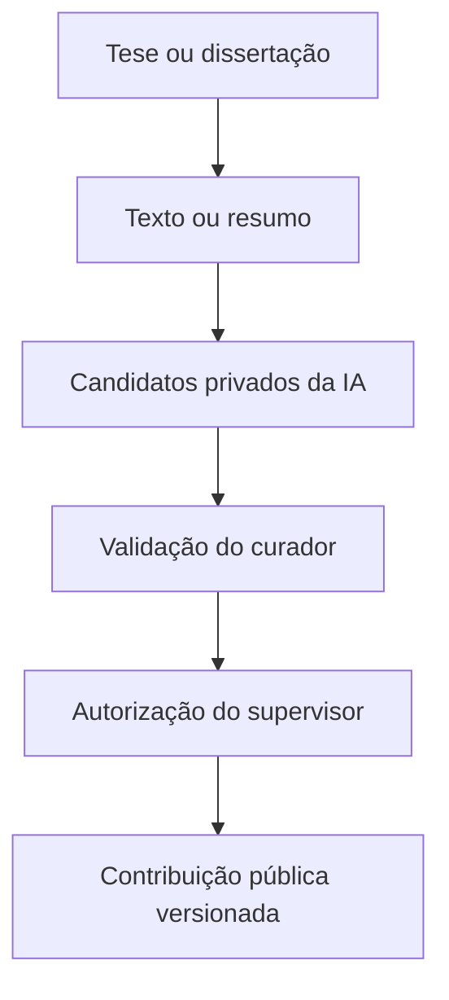
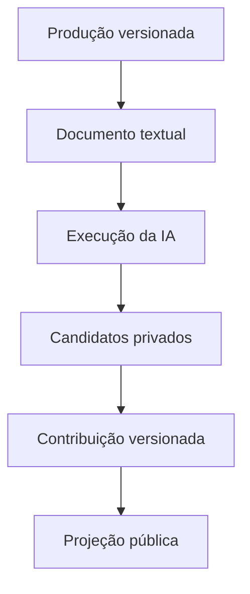
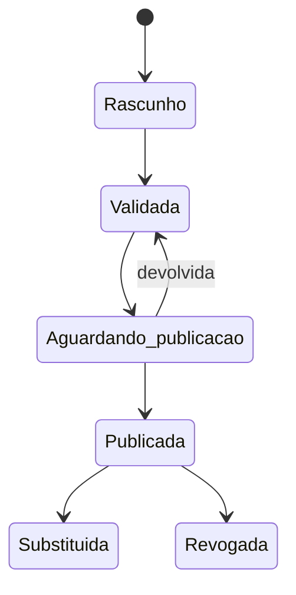

# ObservAInova — Fase 2: contribuição científica e governança

**Versão:** 1.0  
**Data:** 23 de setembro de 2026  
**Status:** aprovado pelo usuário em 6 de outubro de 2026
**Escopo:** extração candidata, validação humana, publicação e revogação de contribuições científicas  
**Complementa:** `2026-09-21-problem-centered-innovation-ecosystem-design.md`  
**Substitui para esta fase:** o plano de validação semântica de 8 de setembro de 2026  

## 1. Decisão central

A fase 2 transforma teses e dissertações em contribuições científicas rastreáveis, mas não transforma automaticamente documentos em soluções. A tese ou dissertação permanece como fonte; a contribuição científica validada passa a ser a unidade pública de conhecimento.

A sequência obrigatória é:



Esta fase termina na publicação segura das contribuições. Recuperação híbrida, mapas de caminhos de solução, combinação de contribuições e Salas de Desafio pertencem às fases posteriores.

## 2. Resultado esperado

Ao final da fase 2, o sistema deverá:

- obter texto de PDFs abertos e pesquisáveis sem romper as regras de direitos;
- usar o resumo como fonte subsidiária quando o texto completo não puder ser analisado;
- identificar, por IA, candidatos a contribuições e seus fundamentos textuais;
- manter integralmente privada toda interpretação automática ainda não validada;
- permitir revisão humana campo a campo por um curador;
- exigir autorização de pessoa diferente, no papel de supervisor, para publicação;
- publicar versões imutáveis, rastreáveis e revogáveis;
- oferecer contribuições públicas como fundamento científico para a futura busca orientada por problemas;
- produzir dados de avaliação da extração, da curadoria e da governança.

## 3. Limites da fase

### 3.1 Incluído

- representação versionada do texto documental;
- preservação de páginas, seções, posições e hashes;
- adaptador de IA independente de fornecedor;
- execuções de extração reprodutíveis e auditáveis;
- candidatos, campos e trechos de fundamento privados;
- fila estratificada de validação;
- console de curadoria e supervisão;
- publicação, substituição e revogação;
- índices ou projeções fisicamente/lógicamente separados por visibilidade;
- páginas e endpoints públicos de contribuições publicadas;
- instrumentação para avaliação científica.

### 3.2 Não incluído

- OCR automático integrado ao pipeline inicial;
- geração de mapas ou caminhos de solução;
- síntese automática de várias fontes;
- ranqueamento contextual completo entre um problema e contribuições;
- salas colaborativas, experimentos ou aprendizagem de aplicação;
- artigos, patentes ou outros tipos documentais;
- validação aberta por usuários externos;
- ingestão de produções de instituições externas apenas por estudarem Pernambuco;
- escolha definitiva de um fornecedor de IA ou identidade.

## 4. Corpus e fontes

| Dimensão | Decisão |
|---|---|
| Instituições | Universidades e institutos públicos de ensino e pesquisa sediados em Pernambuco |
| Fontes | Repositórios institucionais e sistemas oficiais equivalentes |
| Tipos | Teses e dissertações |
| Corpus analítico | 2016 a 2025 |
| Camada corrente | Registros de 2026 acompanhados separadamente |
| Áreas | Todas as áreas do conhecimento desde o início |
| Critério territorial | Vínculo da produção com instituição pública sediada em Pernambuco |
| Universo externo sobre Pernambuco | Adiado |
| Fontes-piloto | UFPE e IFPE |
| Priorização humana | Amostra estratificada e representativa |

O recorte temporal organiza a análise da tese e a fila prioritária; registros anteriores eventualmente preservados não precisam ser descartados.

## 5. Atores e autoridade

| Ator | Autoridade |
|---|---|
| Usuário público | Consultar metadados e contribuições publicadas |
| IA | Sugerir candidatos, campos, confiança e fundamentos; nunca validar ou publicar |
| Curador | Conferir, corrigir, aceitar ou rejeitar campo a campo |
| Supervisor | Devolver, publicar, substituir ou revogar uma contribuição |
| Administrador | Gerenciar usuários, fontes, instituições, taxonomias e integrações técnicas |

Regras de separação:

1. autoridade administrativa não implica autoridade científica;
2. curador e supervisor devem ser pessoas diferentes para a mesma versão;
3. parecer externo pode informar a decisão, mas não substitui a equipe central;
4. toda decisão registra pessoa, papel, data, justificativa e valores afetados;
5. a IA não possui transição válida para qualquer estado público.

## 6. Arquitetura escolhida

A arquitetura canônica será **relacional, auditável e versionada**, com PostgreSQL como fonte oficial. A camada semântica será uma projeção reconstruível, inicialmente apoiada por `pgvector`; não haverá banco de grafo separado.



Princípios:

- o banco relacional preserva identidades, versões, decisões e relacionamentos;
- índices textuais e vetoriais são derivados e reconstruíveis;
- candidatos e contribuições públicas nunca compartilham o mesmo contrato de consulta;
- eventos de publicação serão entregues por uma outbox transacional;
- registros históricos críticos serão acrescentados, não sobrescritos.

## 7. Modelo conceitual

### 7.1 Entidades já existentes preservadas

- `Source`, `HarvestRun`, `RawRecord` e `RawRecordObject` preservam origem, coleta, conteúdo bruto e direitos;
- `Production` representa a identidade canônica da produção;
- `ProductionVersion` preserva cada versão normalizada dos metadados;
- `AuditEvent` registra ações relevantes;
- as entidades do módulo `problems` permanecem responsáveis pela formulação do problema público.

### 7.2 Representação documental

| Entidade lógica | Responsabilidade |
|---|---|
| Documento-fonte | Vincular uma versão da produção ao PDF, resumo ou outra manifestação permitida |
| Versão textual | Preservar o texto normalizado, origem, método, idioma, hash e estado |
| Página/segmento | Manter número da página, seção, texto e posições estáveis |
| Ocorrência operacional | Registrar falha, restrição, necessidade de OCR ou indisponibilidade |

A versão textual deverá distinguir:

- `full_text`: texto completo aberto e extraível;
- `abstract_only`: somente resumo disponível ou utilizável;
- `ocr_required`: PDF sem camada textual confiável;
- `restricted`: conteúdo que os direitos impedem de armazenar ou processar;
- `failed`: recuperação ou extração malsucedida;
- `superseded`: representação substituída por uma nova versão.

O texto não será publicado automaticamente. Seu objetivo primário é fundamentar a extração e a validação internas.

### 7.3 Extração candidata

| Entidade lógica | Responsabilidade |
|---|---|
| Execução de extração | Registrar provedor, modelo, versão do prompt/esquema, parâmetros, texto de entrada, início, fim e resultado |
| Contribuição candidata | Agrupar os campos que a IA atribui à mesma possível contribuição |
| Alegação candidata | Armazenar um campo sugerido, valor, confiança e observações |
| Trecho de fundamento | Relacionar a alegação com página, seção, posições, citação e hash |

Uma execução pode produzir zero, uma ou várias contribuições candidatas. Uma contribuição candidata pode conter várias alegações, e cada alegação pode possuir um ou vários fundamentos.

Os campos candidatos são:

- problema ou fenômeno investigado;
- tipo de contribuição;
- descrição;
- mecanismo;
- população, serviço e território;
- metodologia;
- evidências e resultados;
- barreiras e limitações;
- condições de aplicabilidade;
- recursos necessários;
- maturidade;
- riscos e contraindicações.

### 7.4 Contribuição científica validada

| Entidade lógica | Responsabilidade |
|---|---|
| Contribuição científica | Identidade estável de uma unidade de conhecimento originada de uma produção |
| Versão da contribuição | Fotografia imutável dos campos científicos em um momento |
| Fundamento validado | Vínculo entre campo, versão textual e trecho confirmado |
| Decisão de campo | Aceitação, correção, rejeição ou declaração de insuficiência |
| Decisão de publicação | Devolução, autorização, substituição ou revogação |
| Evento de outbox | Solicitação transacional de construção/remoção da projeção pública |

Uma produção pode originar zero, uma ou várias contribuições. Nesta fase, cada contribuição se vincula a uma única produção canônica e pode possuir vários trechos da mesma versão documental. Sínteses entre produções serão modeladas somente na fase de caminhos.

### 7.5 Proveniência obrigatória por campo

Cada campo publicável deve registrar:

- origem `full_text` ou `abstract_only`;
- versão textual utilizada;
- página inicial e final, quando existentes;
- seção, quando identificada;
- posição inicial e final no texto normalizado;
- citação de conferência;
- hash da citação;
- execução e alegação candidatas de origem, quando aplicáveis;
- decisão humana, pessoa responsável e data.

Quando a origem for o resumo, a página poderá ser nula, mas a seção deverá ser `abstract` e as posições textuais continuarão obrigatórias. A interface pública exibirá **evidência limitada ao resumo**.

## 8. Estados e transições

### 8.1 Documento textual

```text
pending -> retrieved -> text_extracted
                    -> abstract_only
                    -> ocr_required
                    -> restricted
                    -> failed
text_extracted|abstract_only -> superseded
```

### 8.2 Execução de extração

```text
queued -> running -> succeeded
                  -> failed
succeeded|failed -> superseded
```

### 8.3 Candidato privado

```text
generated -> in_review -> accepted
                       -> rejected
generated|in_review|accepted -> superseded
```

Aceitar um candidato não o publica. A aceitação copia seus valores para um rascunho de contribuição, mantendo o vínculo de proveniência.

### 8.4 Versão da contribuição



Invariantes:

- todos os campos obrigatórios precisam de decisão antes de `validated`;
- uma versão não pode autorizar a própria publicação;
- `publication_pending` só chega a `published` após confirmação da projeção pública;
- versões publicadas são imutáveis;
- correções geram nova versão;
- substituição e revogação retiram a versão anterior da busca pública sem apagar o histórico.

## 9. Fluxo operacional

### 9.1 Coleta e atualização

1. o conector coleta metadados e proveniência;
2. a normalização cria ou reutiliza a produção canônica;
3. uma mudança na fonte gera nova `ProductionVersion`;
4. a qualificação verifica elegibilidade, direitos e disponibilidade documental;
5. o pipeline evita duplicação por identidade, versão, checksum e chave de operação.

### 9.2 Obtenção e preparação do conteúdo

1. localizar a manifestação oficial;
2. registrar instantâneo dos direitos;
3. armazenar o arquivo somente quando permitido;
4. extrair texto preservando paginação e seções;
5. validar se a camada textual é suficiente;
6. usar o resumo como alternativa explicitamente marcada;
7. encaminhar documentos digitalizados para `ocr_required`.

OCR não será requisito de conclusão desta fase. A fila preservará o documento, o motivo e a possibilidade de tratamento futuro ou manual.

### 9.3 Extração por IA

O serviço dependerá de uma interface `ExtractionProvider`, e não diretamente de um SDK comercial. O contrato receberá uma versão textual e um esquema versionado e retornará candidatos estruturados com fundamentos.

Serão disponibilizados:

- provedor determinístico para testes;
- adaptador vivo selecionado por configuração de ambiente;
- validação rígida do payload recebido;
- registro de modelo, parâmetros e versão das instruções;
- timeout, tentativas limitadas e falha segura;
- continuidade manual quando o provedor estiver indisponível.

Uma nova execução não substitui silenciosamente a anterior. Reprocessamentos criam nova execução e marcam a relação de supersessão.

### 9.4 Priorização da validação

A primeira fila usará amostragem estratificada por:

- instituição;
- área do conhecimento;
- ano;
- mestrado ou doutorado;
- texto completo ou somente resumo;
- tipo de contribuição sugerido.

A fila precisa guardar a versão da regra de amostragem e o motivo da prioridade. Depois da calibração, o mesmo fluxo poderá abranger progressivamente todo o corpus.

### 9.5 Curadoria campo a campo

O curador poderá:

- conferir o trecho no contexto da página;
- aceitar o valor sugerido;
- corrigir valor e fundamento;
- rejeitar um campo ou candidato;
- marcar informação insuficiente;
- dividir uma contribuição candidata;
- unir candidatos da mesma produção quando houver justificativa;
- registrar observação metodológica;
- enviar a versão validada para supervisão.

Nenhum valor será inferido pelo sistema durante a correção sem aparecer como nova sugestão identificada. A decisão humana prevalece sobre a candidata.

### 9.6 Supervisão e publicação

O supervisor poderá:

- devolver a versão com justificativa;
- autorizar publicação;
- autorizar substituição;
- revogar uma versão publicada.

A autorização cria atomicamente a decisão, a versão imutável e o evento de outbox. Um trabalhador constrói a projeção pública e confirma a transição final. Falha de projeção mantém a versão em `publication_pending`.

## 10. Identidade e autorização

A autenticação interna usará OIDC independente de fornecedor.

- produção: emissor, audiência e mapeamento de papéis configuráveis;
- desenvolvimento: tokens locais assinados e com expiração curta;
- identidade interna: `issuer + subject`, nunca e-mail isolado;
- autorização: papéis e verificações no serviço, não somente na interface;
- rotas públicas: sem credenciais internas e sem dependência do índice privado.

Papéis mínimos: `curator`, `supervisor` e `admin`. Um usuário pode acumular papéis, mas a regra de quatro olhos será verificada pelo identificador da pessoa em cada contribuição.

## 11. Separação pública e privada

Serão mantidos três contextos de recuperação:

1. **metadados públicos** — produções qualificadas;
2. **candidatos privados** — textos de trabalho, alegações, confiança, rejeições e anotações;
3. **inteligência validada pública** — somente versões publicadas e ativas.

Controles obrigatórios:

- consultas públicas usam repositórios, schemas e projeções próprios;
- a camada pública não aceita estado como parâmetro para ampliar visibilidade;
- embeddings candidatos permanecem em coleção privada;
- respostas públicas não incluem confiança da IA como selo científico;
- candidatos rejeitados permanecem disponíveis apenas à avaliação interna;
- testes negativos verificam que nenhum identificador, trecho ou embedding privado vaza.

## 12. Contratos de serviço

Os nomes são orientadores e serão refinados no plano de implementação.

### 12.1 Internos

| Operação | Resultado |
|---|---|
| Listar fila documental | Itens pendentes, falhos, restritos ou aguardando OCR |
| Preparar texto | Nova versão textual ou estado operacional explícito |
| Solicitar extração | Execução idempotente vinculada ao texto e ao esquema |
| Consultar fila de revisão | Candidatos privados segundo prioridade e permissão |
| Registrar decisão de campo | Evento append-only e rascunho atualizado |
| Dividir/unir candidato | Novos agrupamentos com justificativa e linhagem |
| Enviar à supervisão | Versão validada imutável |
| Decidir publicação | Devolução, autorização, substituição ou revogação |
| Reprocessar projeção | Nova tentativa idempotente do evento de outbox |

### 12.2 Públicos

| Operação | Resultado |
|---|---|
| Consultar metadado | Produção qualificada e fonte oficial |
| Listar contribuições publicadas | Versões ativas, filtros permitidos e paginação |
| Consultar contribuição | Campos validados, fundamentos, limites, versão e data |
| Consultar fundamento | Produção, localização, trecho permitido e proveniência |

O módulo público de contribuições será a fonte da futura fase `matching`. Ele não produzirá mapas de solução nesta fase.

## 13. Experiência da equipe central

### 13.1 Painel operacional

O painel exibirá contagens e filas de:

- documentos a recuperar;
- textos extraídos;
- itens com resumo apenas;
- itens aguardando OCR;
- execuções em andamento ou falhas;
- candidatos aguardando curadoria;
- versões aguardando supervisão;
- publicações pendentes de projeção;
- fontes alteradas e contribuições que precisam de revisão.

### 13.2 Tela de curadoria

A tela será dividida entre:

- texto-fonte com navegação por página e seção;
- contribuições candidatas;
- campos, confiança e fundamentos;
- decisão e edição por campo;
- histórico e observações.

Selecionar um campo deverá destacar todos os trechos associados. A interface não esconderá ausência de fundamento nem permitirá validar em lote campos críticos sem confirmação explícita.

### 13.3 Tela de supervisão

O supervisor verá:

- versão proposta e origem;
- decisões do curador;
- campos alterados em relação à candidata;
- fundamentos validados;
- alertas de resumo apenas, baixa confiança ou fonte indisponível;
- histórico de versões e justificativas;
- ações de devolver, publicar, substituir ou revogar.

## 14. Experiência pública

O resultado público principal será a contribuição, apresentada pelas perguntas:

1. o que esta pesquisa ajuda a compreender ou fazer?
2. para qual problema ela pode contribuir?
3. quais evidências sustentam essa contribuição?
4. em quais condições ela pode ser aplicada?
5. quais são seus limites, riscos e barreiras?

Cada página mostrará tipo, descrição, evidências, população, serviço, território, aplicabilidade, maturidade, limitações, instituição, validação e acesso à produção original.

A linguagem usará **contribuição potencialmente útil**, e não promessa de solução. Metadados de fontes ainda não analisadas poderão ser públicos, mas nunca aparecerão como inteligência validada.

## 15. Direitos, segurança e auditoria

- texto completo só será armazenado/processado conforme a política da fonte;
- conteúdo protegido não será redistribuído pela plataforma;
- trechos públicos serão mínimos, justificados e vinculados à fonte;
- credenciais e tokens nunca entrarão em logs ou eventos de auditoria;
- autorização seguirá o menor privilégio;
- eventos científicos relevantes serão append-only;
- arquivos, textos e trechos terão hashes de integridade;
- cópias de segurança e restauração serão testadas;
- a remoção da fonte não apagará a proveniência, mas acionará revisão;
- dados de avaliação identificarão papéis sem expor informações pessoais desnecessárias.

## 16. Comportamento em falhas

| Situação | Comportamento |
|---|---|
| Repositório indisponível | Retentativa limitada e retomada por cursor, sem duplicação |
| Arquivo corrompido | Falha registrada e fila operacional |
| PDF digitalizado | `ocr_required`, mantendo metadados públicos elegíveis |
| Texto completo indisponível | `abstract_only`, com limitação visível |
| Conteúdo restrito | Sem cópia indevida; metadados e link conforme permissão |
| IA indisponível | Execução falha preservada; continuidade manual possível |
| Payload inválido da IA | Rejeição integral da execução, sem candidatos parciais públicos |
| Confiança baixa | Prioridade de revisão; nunca exclusão automática |
| Fonte alterada | Nova versão textual e revisão das contribuições afetadas |
| Projeção pública falha | Estado `publication_pending` e retentativa idempotente |
| Contribuição revogada | Remoção pública e retenção integral do histórico |

## 17. Avaliação científica

A fase será avaliada no ciclo de Design Science Research.

### 17.1 Qualidade da coleta

- cobertura por fonte e instituição;
- completude e consistência dos metadados;
- duplicidade e atualização;
- disponibilidade de resumo e texto completo;
- qualidade da proveniência.

### 17.2 Padrão de referência

A amostra estratificada será codificada manualmente. Uma subamostra terá dois curadores independentes e adjudicação das divergências. A amostra será separada em calibração e teste, impedindo que exemplos de ajuste integrem a medição final.

### 17.3 Extração

- precisão, revocação e F1 por campo;
- exatidão do fundamento textual;
- proporção de afirmações sem suporte;
- concordância entre avaliadores;
- desempenho por instituição, área e tipo documental;
- proporção e natureza das correções;
- tempo de validação.

### 17.4 Recuperação e experiência

Quando a fase de busca for integrada, o protocolo comparará acesso convencional por palavras-chave com acesso orientado por problema, usando:

- Precisão@k, nDCG@k e posição do primeiro resultado útil;
- tempo e sucesso em tarefas;
- diversidade de áreas e instituições;
- compreensão de evidências e limitações;
- usabilidade, utilidade percebida e intenção de uso;
- entrevistas com gestores, pesquisadores, profissionais da informação, profissionais de inovação, especialistas e representantes sociais.

### 17.5 Governança

- 100% das contribuições públicas com curadoria e supervisão;
- 100% dos campos críticos com proveniência;
- zero exposição pública de candidatos privados;
- separação de pessoas na regra de quatro olhos;
- completude da auditoria;
- tempo de publicação, devolução e correção;
- revogações ausentes do índice público.

Os limiares de desempenho da IA e da recuperação serão definidos após o piloto e registrados antes do teste final.

## 18. Estratégia de testes

### 18.1 Domínio e banco

- migração ascendente e descendente em banco limpo;
- constraints de estados e relacionamentos;
- imutabilidade de versões publicadas;
- append-only das decisões;
- impossibilidade de autopublicação;
- substituição e revogação sem perda histórica.

### 18.2 Documento e IA

- paginação e offsets reproduzíveis;
- hashes consistentes;
- fallback para resumo;
- detecção de necessidade de OCR;
- provedor determinístico;
- rejeição de payload inválido;
- reprocessamento sem sobrescrita;
- timeout e falha segura.

### 18.3 APIs e autorização

- OIDC válido, expirado, com emissor/audiência incorretos;
- permissões por papel;
- quatro olhos no serviço;
- schemas públicos sem campos internos;
- testes negativos de vazamento entre os três contextos;
- paginação, filtros e ordenação determinísticos.

### 18.4 Fluxo ponta a ponta

1. ingerir produção de fixture;
2. criar versão textual com páginas;
3. executar provedor determinístico;
4. revisar campo a campo;
5. enviar à supervisão;
6. publicar por pessoa diferente;
7. confirmar projeção pública;
8. criar correção e nova versão;
9. substituir ou revogar;
10. verificar índice público e auditoria.

## 19. Critérios de aceitação

A fase 2 estará concluída quando:

- PDFs pesquisáveis e resumos elegíveis produzirem versões textuais rastreáveis;
- PDFs sem texto entrarem em fila explícita de OCR/revisão;
- o adaptador determinístico demonstrar extração reprodutível;
- cada candidato permanecer privado e possuir fundamento recuperável;
- o curador conseguir decidir todos os campos e justificar alterações;
- o supervisor, sendo pessoa diferente, conseguir publicar, devolver, substituir e revogar;
- a projeção pública contiver exclusivamente versões publicadas e ativas;
- falha de projeção não causar publicação parcial;
- a página pública apresentar contribuição, evidências, aplicabilidade, limites e fonte;
- metadados continuarem disponíveis antes da inteligência validada;
- auditoria reconstruir toda a linhagem da fonte à versão pública;
- testes automatizados comprovarem as fronteiras de visibilidade e autoridade;
- métricas necessárias ao protocolo da tese puderem ser exportadas.

## 20. Consequências para o planejamento

O plano técnico da fase 2 deverá partir da migração atual `0010_public_problem_formulation` e não reutilizar literalmente o plano de validação semântica de 8 de setembro. A ordem de dependência recomendada é:

1. identidade interna e autorização;
2. representação documental;
3. contrato e execução de extração;
4. candidatos e fundamentos privados;
5. curadoria campo a campo;
6. contribuições e versões;
7. supervisão, outbox e projeção pública;
8. interfaces internas e públicas;
9. instrumentação e protocolo de avaliação.

Essa sequência é apenas uma restrição arquitetural. Arquivos, migrações, testes e incrementos executáveis serão detalhados no plano de implementação após a aprovação final desta especificação.

## 21. Decisões fechadas

- banco relacional canônico com camada semântica reconstruível;
- texto completo aberto como fonte primária e resumo como fallback rotulado;
- PDF digitalizado em fila de OCR/revisão, sem OCR obrigatório nesta fase;
- IA por interface independente e provedor configurável;
- validação humana de todos os registros antes da inteligência pública;
- curador e supervisor como autoridades distintas;
- metadados públicos antes da validação;
- candidatos da IA integralmente privados;
- publicação versionada, imutável, substituível e revogável;
- amostra inicial estratificada e representativa;
- fase encerrada na contribuição publicada, sem antecipar caminhos ou salas.
